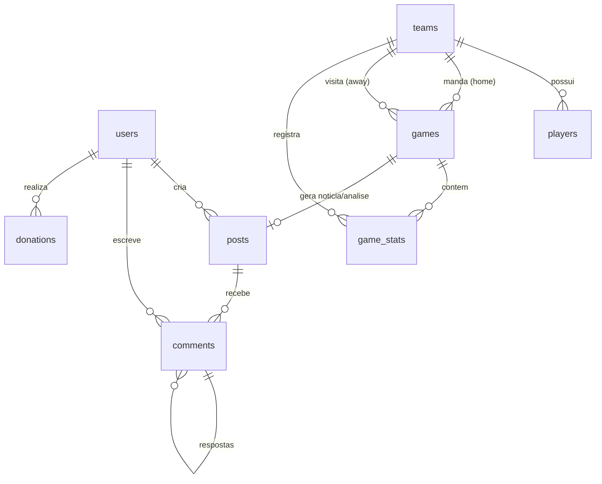
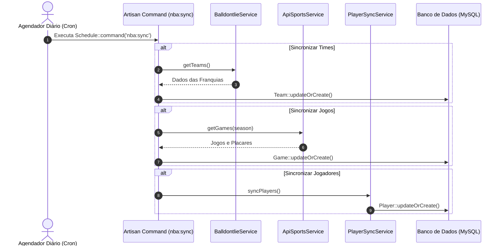

# 🏀 Basq NBA — Plano Técnico & Documentação de Arquitetura

## 1. Visão Geral

O **Basq NBA** é uma plataforma web completa desenvolvida com **Laravel 13** e **PHP 8.3+** com foco em cobertura da NBA, estatísticas de franquias e atletas, calendário e resultados de partidas, notícias, análises táticas, moderação comunitária e arrecadação de apoio financeiro via Pix com QR Code dinâmico.

O projeto foi construído seguindo boas práticas de arquitetura MVC em camadas, integrando APIs esportivas externas, persistência de preferências de usuário (tema escuro/claro e idioma PT/EN), sistema de filas e cache, e painel administrativo protegido.

---

## 2. Modelagem do Banco de Dados

### 2.1 Diagrama Entidade-Relacionamento



---

### 2.2 Estrutura das Tabelas Principais

```
users
├── id (PK, bigint, auto_increment)
├── name (string, 255)
├── email (string, 255, unique)
├── email_verified_at (datetime, nullable)
├── password (string, 255)
├── role (enum: 'admin', 'user') DEFAULT 'user'
├── avatar (string, 255, nullable)
├── is_blocked (boolean) DEFAULT false
├── locale (enum: 'pt', 'en') DEFAULT 'pt'
├── theme_preference (enum: 'light', 'dark') DEFAULT 'light'
├── notify_email (boolean) DEFAULT true
├── remember_token (string, 100, nullable)
├── created_at (timestamp)
├── updated_at (timestamp)
└── INDEX: email

teams
├── id (PK, bigint, auto_increment)
├── api_id (integer, unique, nullable)
├── nba_api_id (integer, unique, nullable)
├── name (string, 255)
├── abbreviation (string, 10)
├── city (string, 255)
├── state (string, 255, nullable)
├── conference (enum: 'East', 'West')
├── division (string, 255)
├── arena_name (string, 255, nullable)
├── arena_capacity (integer, nullable)
├── arena_location (string, 255, nullable)
├── founded_year (integer, nullable)
├── championships_count (integer) DEFAULT 0
├── logo_url (string, 500, nullable)
├── created_at (timestamp)
├── updated_at (timestamp)
└── INDEX: abbreviation, conference

players
├── id (PK, bigint, auto_increment)
├── api_id (integer, unique, nullable)
├── apisports_id (integer, unique, nullable)
├── team_id (FK → teams.id, SET NULL, nullable)
├── first_name (string, 255)
├── last_name (string, 255)
├── slug (string, 191, unique)
├── position (string, 10, nullable)
├── jersey_number (string, 10, nullable)
├── height (string, 10, nullable)
├── height_meters (decimal, 4,2, nullable)
├── weight (integer, nullable)
├── weight_kg (decimal, 5,2, nullable)
├── birth_date (date, nullable)
├── country (string, 80, nullable)
├── college (string, 255, nullable)
├── draft_year (smallInteger, nullable)
├── draft_round (smallInteger, nullable)
├── draft_number (smallInteger, nullable)
├── career_start (smallInteger, nullable)
├── seasons_played (smallInteger, nullable)
├── is_active (boolean) DEFAULT true
├── season (string, 10, nullable)
├── created_at (timestamp)
├── updated_at (timestamp)
└── INDEX: team_id, position, last_name, is_active

games
├── id (PK, bigint, auto_increment)
├── api_id (integer, unique, nullable)
├── home_team_id (FK → teams.id, CASCADE)
├── away_team_id (FK → teams.id, CASCADE)
├── game_date (datetime)
├── arena (string, 255, nullable)
├── status (enum: 'scheduled', 'live', 'finished') DEFAULT 'scheduled'
├── home_score (integer) DEFAULT 0
├── away_score (integer) DEFAULT 0
├── season (string, 9)
├── highlights (json, nullable)
├── admin_analysis (text, nullable)
├── analysis_text (text, nullable)
├── analysis_text_en (text, nullable)
├── created_at (timestamp)
├── updated_at (timestamp)
├── INDEX: game_date, status, season
└── FOREIGN KEYS: home_team_id, away_team_id

game_stats
├── id (PK, bigint, auto_increment)
├── game_id (FK → games.id, CASCADE)
├── team_id (FK → teams.id, CASCADE)
├── field_goals_made (integer) DEFAULT 0
├── field_goals_attempted (integer) DEFAULT 0
├── three_pointers_made (integer) DEFAULT 0
├── three_pointers_attempted (integer) DEFAULT 0
├── free_throws_made (integer) DEFAULT 0
├── free_throws_attempted (integer) DEFAULT 0
├── rebounds (integer) DEFAULT 0
├── assists (integer) DEFAULT 0
├── steals (integer) DEFAULT 0
├── blocks (integer) DEFAULT 0
├── turnovers (integer) DEFAULT 0
├── points (integer) DEFAULT 0
├── created_at (timestamp)
├── updated_at (timestamp)
└── INDEX: game_id, team_id

posts
├── id (PK, bigint, auto_increment)
├── user_id (FK → users.id, CASCADE)
├── game_id (FK → games.id, SET NULL, nullable)
├── title (string, 255)
├── slug (string, 255, unique)
├── content (longText)
├── excerpt (text, nullable)
├── cover_image (string, 500, nullable)
├── category (enum: 'noticia', 'jogo', 'estatistica', 'recente', 'analise')
├── status (enum: 'draft', 'published') DEFAULT 'draft'
├── published_at (datetime, nullable)
├── views_count (integer) DEFAULT 0
├── created_at (timestamp)
├── updated_at (timestamp)
├── INDEX: slug, category, status, published_at
└── FULLTEXT: title, content

comments
├── id (PK, bigint, auto_increment)
├── user_id (FK → users.id, CASCADE)
├── post_id (FK → posts.id, CASCADE)
├── parent_id (FK → comments.id, SET NULL, nullable)
├── content (text)
├── approved (boolean) DEFAULT false
├── created_at (timestamp)
├── updated_at (timestamp)
└── INDEX: post_id, approved

donations
├── id (PK, bigint, auto_increment)
├── user_id (FK → users.id, SET NULL, nullable)
├── amount (decimal, 10,2)
├── transaction_id (string, 255, unique)
├── status (enum: 'pending', 'confirmed', 'failed') DEFAULT 'pending'
├── qr_code_payload (text, nullable)
├── qr_code_image (text, nullable)
├── donor_name (string, 255, nullable)
├── donor_email (string, 255, nullable)
├── message (text, nullable)
├── paid_at (datetime, nullable)
├── created_at (timestamp)
├── updated_at (timestamp)
├── INDEX: status, transaction_id
└── FOREIGN KEY: user_id
```

---

## 3. Estrutura de Rotas

```php
// routes/web.php

// ===== PÚBLICAS =====
Route::get('/', [HomeController::class, 'index'])->name('home');

// Notícias & Recentes
Route::get('/noticias', [PostController::class, 'index'])->name('noticias.index');
Route::get('/noticias/{post:slug}', [PostController::class, 'show'])->name('noticias.show');
Route::get('/recentes', [PostController::class, 'recentes'])->name('recentes.index');
Route::get('/recentes/{post:slug}', [PostController::class, 'showRecente'])->name('recentes.show');

// Jogos & Calendário
Route::get('/jogos', [GameController::class, 'index'])->name('jogos.index');
Route::get('/jogos/{game}', [GameController::class, 'show'])->name('jogos.show');

// Estatísticas & Franquias
Route::get('/estatisticas', [StatsController::class, 'index'])->name('estatisticas.index');
Route::get('/estatisticas/{team:abbreviation}', [StatsController::class, 'showTeam'])->name('estatisticas.team');

// Jogadores
Route::get('/jogadores', [PlayerController::class, 'index'])->name('jogadores.index');
Route::get('/jogadores/{player:slug}', [PlayerController::class, 'show'])->name('jogadores.show');

// Doações via Pix
Route::get('/doacoes', [DonationController::class, 'index'])->name('donations.index');
Route::post('/doacoes/gerar-pix', [DonationController::class, 'generatePix'])->name('donations.generate');
Route::post('/doacoes/webhook', [DonationController::class, 'webhook'])->name('donations.webhook');

// Preferências Globais
Route::post('/locale', LocaleController::class)->name('locale');
Route::post('/theme', ThemeController::class)->name('theme');

// ===== AUTENTICAÇÃO & PERFIL =====
Route::middleware('auth')->group(function () {
    Route::post('logout', [AuthenticatedSessionController::class, 'destroy'])->name('logout');
    Route::get('profile', [ProfileController::class, 'edit'])->name('profile.edit');
    Route::patch('profile', [ProfileController::class, 'update'])->name('profile.update');
    Route::delete('profile', [ProfileController::class, 'destroy'])->name('profile.destroy');

    // Comentários em notícias
    Route::post('/posts/{post}/comentarios', [CommentController::class, 'store'])->name('comments.store');
});

// ===== ADMINISTRAÇÃO =====
Route::middleware(['auth', 'admin'])->prefix('admin')->name('admin.')->group(function () {
    Route::get('/', [AdminDashboardController::class, 'index'])->name('dashboard');

    // Recursos CRUD
    Route::resource('posts', AdminPostController::class);
    Route::resource('games', AdminGameController::class);
    Route::resource('stats', AdminStatsController::class);
    Route::resource('teams', AdminTeamController::class);

    // Jogadores (edição de complementos)
    Route::get('/jogadores', [AdminPlayerController::class, 'index'])->name('players.index');
    Route::get('/jogadores/{player}/editar', [AdminPlayerController::class, 'edit'])->name('players.edit');
    Route::put('/jogadores/{player}', [AdminPlayerController::class, 'update'])->name('players.update');

    // Moderação de Comentários
    Route::get('/comentarios', [AdminCommentController::class, 'index'])->name('comments.index');
    Route::post('/comentarios/{comment}/aprovar', [AdminCommentController::class, 'approve'])->name('comments.approve');
    Route::delete('/comentarios/{comment}', [AdminCommentController::class, 'destroy'])->name('comments.destroy');
    Route::post('/comentarios/{comment}/excluir', [AdminCommentController::class, 'destroy'])->name('comments.delete');

    // Gestão de Usuários
    Route::get('/usuarios', [AdminUserController::class, 'index'])->name('users.index');
    Route::post('/usuarios/{user}/bloquear', [AdminUserController::class, 'block'])->name('users.block');
    Route::delete('/usuarios/{user}', [AdminUserController::class, 'destroy'])->name('users.destroy');

    // Doações
    Route::get('/doacoes', [AdminDonationController::class, 'index'])->name('donations.index');

    // Sincronização e utilitários
    Route::post('/sync/teams', [AdminSyncController::class, 'syncTeams'])->name('sync.teams');
    Route::post('/sync/games', [AdminSyncController::class, 'syncGames'])->name('sync.games');
    Route::get('/api/search-teams', [AdminApiController::class, 'searchTeams'])->name('api.search-teams');
    Route::get('/api/team-info', [AdminApiController::class, 'getTeamInfo'])->name('api.team-info');
});
```

---

## 4. Estrutura de Controllers

```
app/Http/Controllers/
├── Admin/
│   ├── AdminApiController.php         ← Endpoints JSON auxiliares (busca e info de times)
│   ├── AdminCommentController.php     ← Moderação e exclusão de comentários
│   ├── AdminDashboardController.php   ← Métricas consolidadas do dashboard
│   ├── AdminDonationController.php    ← Visualização das transações Pix
│   ├── AdminGameController.php        ← CRUD e edição de jogos
│   ├── AdminPlayerController.php      ← Edição de atletas
│   ├── AdminPostController.php        ← CRUD de matérias e análises
│   ├── AdminStatsController.php       ← CRUD de estatísticas de confrontos
│   ├── AdminSyncController.php        ← Disparador web de sincronização das APIs
│   ├── AdminTeamController.php        ← CRUD e personalização de franquias
│   └── AdminUserController.php        ← Bloqueio e gerência de contas de usuários
├── Auth/
│   ├── AuthenticatedSessionController.php
│   ├── ConfirmablePasswordController.php
│   ├── EmailVerificationNotificationController.php
│   ├── EmailVerificationPromptController.php
│   ├── NewPasswordController.php
│   ├── PasswordResetLinkRequestController.php
│   ├── RegisteredUserController.php
│   └── VerifyEmailController.php
├── CommentController.php              ← Criação de comentários vinculados a matérias
├── DonationController.php             ← Geração de Pix e webhook de pagamento
├── GameController.php                 ← Calendário, detalhes e placares de jogos
├── HomeController.php                 ← Agregador da Home
├── LocaleController.php               ← Toggle de idioma (pt/en)
├── PlayerController.php               ← Busca, listagem e perfil de jogadores
├── PostController.php                 ← Listagem e exibição de Notícias e Recentes
├── ProfileController.php              ← Edição de perfil e preferências
├── StatsController.php                ← Classificação e visualização de franquias
└── ThemeController.php                ← Toggle de tema (claro/escuro)
```

---

## 5. Estrutura de Views

```
resources/views/
├── admin/                             # Telas administrativas
│   ├── comments/                      # Moderação de comentários
│   ├── donations/                     # Listagem de doações Pix
│   ├── games/ & jogos/                # Gestão de jogos
│   ├── players/                       # Edição de jogadores
│   ├── posts/ & noticias/             # Gestão de matérias
│   ├── stats/ & estatisticas/         # Gestão de estatísticas
│   ├── teams/                         # Gestão de franquias
│   ├── users/                         # Gestão de usuários
│   └── dashboard.blade.php            # Dashboard principal
├── auth/                              # Telas de autenticação (Breeze)
│   ├── login.blade.php
│   ├── register.blade.php
│   ├── forgot-password.blade.php
│   ├── reset-password.blade.php
│   ├── verify-email.blade.php
│   └── confirm-password.blade.php
├── components/                        # Componentes reutilizáveis
│   ├── game-card.blade.php
│   ├── post-card.blade.php
│   ├── team-card.blade.php
│   └── player-card.blade.php
├── donations/                         # Fluxo de doação via Pix
│   ├── index.blade.php
│   └── pix.blade.php
├── emails/                            # Templates HTML para e-mails (SMTP)
│   └── new_post.blade.php
├── estatisticas/                      # Visualização pública de franquias
│   ├── index.blade.php
│   └── team.blade.php
├── jogos/ & games/                    # Visualização pública de partidas
│   ├── index.blade.php
│   └── show.blade.php
├── jogadores/                         # Visualização pública de atletas
│   ├── index.blade.php
│   └── show.blade.php
├── layouts/                           # Layouts mestres com Bootstrap 5.3
│   ├── app.blade.php                  # Layout principal com barra e footer
│   ├── guest.blade.php                # Layout para telas de login/registro
│   └── navigation.blade.php           # Barra de navegação
├── noticias/ & posts/ & recentes/     # Listagem e leitura de matérias
│   ├── index.blade.php
│   └── show.blade.php
├── profile/                           # Gestão de perfil de usuário
│   ├── edit.blade.php
│   └── partials/
└── home.blade.php                     # Página inicial do portal
```

---

## 6. Arquitetura de Serviços & Sincronização

### 6.1 Services Especializados (`app/Services/`)

1. **`BalldontlieService.php`**: Conecta à API [balldontlie.io](https://balldontlie.io) para obter franquias e catálogo de atletas.
2. **`ApiSportsService.php`**: Conecta à API [v1.basketball.api-sports.io](https://api-sports.io) para obter jogos, placares em tempo real e temporadas.
3. **`PlayerSyncService.php`**: Orquestra a sincronização, enriquecimento e vinculação dos atletas com seus respectivos times.
4. **`PixService.php`**: Gera a payload TLV do padrão Pix EMV (Copia e Cola) e renderiza o QR Code via biblioteca `chillerlan/php-qrcode`.
5. **`NewsGenerator.php`**: Gera resumos jornalísticos automáticos a partir do encerramento das partidas.
6. **`GameAnalysis.php`**: Constrói relatórios analíticos táticos pré e pós-jogo.

---

### 6.2 Fluxo de Sincronização



---

## 7. Status do Desenvolvimento

| Fase | Escopo | Status |
|---|---|:---:|
| **Fase 1: Fundação** | Setup Laravel 13, migrations, models, autenticação Breeze, layout Bootstrap 5 | ✅ Concluído |
| **Fase 2: Páginas Públicas** | Home, Notícias, Recentes, Jogos, Franquias, Jogadores e Análises | ✅ Concluído |
| **Fase 3: Painel Admin** | Dashboard de métricas, moderação de comentários, CRUDs e gestão de contas | ✅ Concluído |
| **Fase 4: APIs & Sync** | Integrações balldontlie.io, API-Sports, comandos Artisan e Scheduler | ✅ Concluído |
| **Fase 5: Doações Pix** | Geração de payload EMV, QR Code interativo e controle de transações | ✅ Concluído |
| **Fase 6: Otimizações** | Tema Claro/Escuro dinâmico, internacionalização PT/EN e Dockerfile | ✅ Concluído |

---

## 8. Comandos Artisan Úteis

```bash
# Sincronização de dados das APIs
php artisan nba:sync
php artisan nba:sync --only=teams
php artisan nba:sync --only=games
php artisan nba:sync --only=players
php artisan nba:sync --season=2024 --fresh

# Gestão de usuários e administradores
php artisan make:user --admin --name="Admin" --email=admin@basqnba.com --password=admin123

# Geração automática de notícias e análises de confrontos
php artisan nba:generate-news
php artisan nba:generate-analysis

# Higienização e ajustes de integridade no banco de dados
php artisan nba:fix-teams
php artisan nba:fix-game-times
php artisan nba:clean-db --dry-run

# Execução do agendador e filas
php artisan schedule:run
php artisan queue:work

# Limpeza completa de cache de aplicação
php artisan optimize:clear
```
